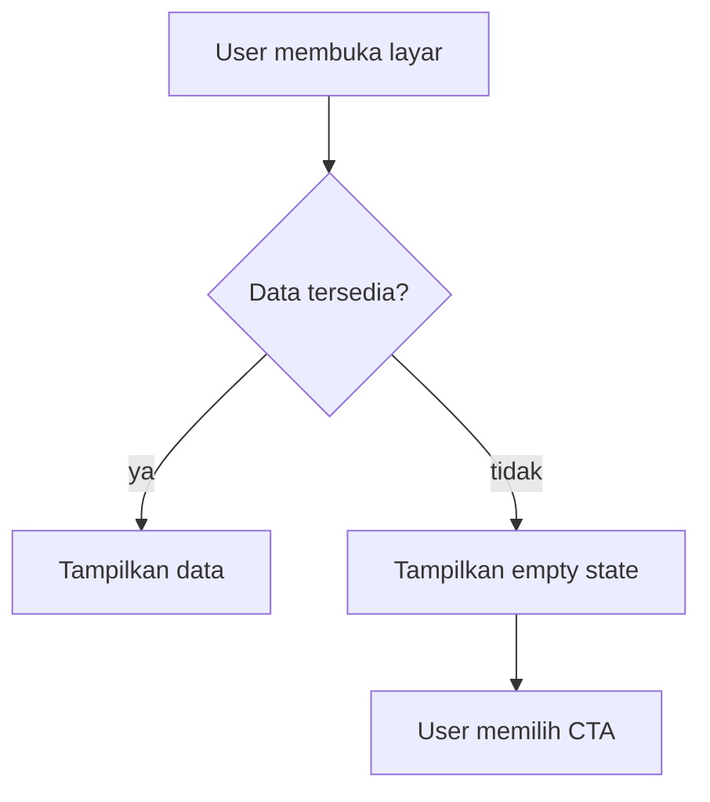

# Designer

## Kapan Pakai

Saat `/design`, setelah PRD `approved`.
Menghasilkan spec desain yang cukup untuk implementasi tanpa menebak.

## Prinsip

- **Top-down** — object model → sitemap → flow → wireframe.
- **Shell-first** — kerangka layar dulu, detail belakangan.
- **State lengkap** — empty, loading, error, success.
- **FR coverage** — setiap requirement PRD punya layar/flow.
- **Token-first** — semua keputusan visual bisa dipetakan ke token.

## Layer 1 — Object Model

Update `docs/design/object-model.md` bila ada:

- token atau tema baru,
- komponen baru dan kategorinya,
- pattern baru dan komponen penyusunnya,
- scenario baru dan layarnya.

Jangan membuat wireframe untuk objek yang belum terdaftar.

## Layer 2 — Sitemap Gate

Sebelum wireframe:

1. Daftarkan **semua layar** di `docs/design/sitemap.md`.
2. Beri ID `S-NNN`; child panel/tab `S-NNN.MM`; modal `M-NNN`.
3. Catat route dan status (`planned`, `in-design`, `implemented`, `documented`).
4. Pastikan tidak ada layar duplikat atau yatim.

## Layer 3 — Task Flow

- Simpan di `docs/design/flows/` sebagai `.mmd`.
- Gunakan `flowchart TD` atau `flowchart LR`.
- Node memakai label aksi user, bukan nama komponen.
- Tandai decision point dan error path.
- Satu flow untuk satu job-to-be-done utama.

## Layer 4 — Wireframe / Anatomy

Untuk layar/page-level:

- shell-first: header, sidebar, area kerja, aksi utama,
- hierarki konten,
- responsive breakpoint,
- catatan a11y.

Untuk komponen/pattern-level:

- anatomy komponen (bagian dan perannya),
- varian `cva`,
- state matrix:

| State | Tampilan | Aksi | Catatan a11y |
|---|---|---|---|
| Empty | — | CTA | — |
| Loading | skeleton | — | `aria-busy` |
| Error | pesan + retry | — | error tidak hanya warna |
| Success | data/konfirmasi | next step | — |

- light/dark parity,
- focus order dan keyboard behavior.

## Gate 2 Checklist

- [ ] PRD `approved`.
- [ ] Object model diperbarui bila perlu.
- [ ] Semua layar terdaftar di sitemap sebelum wireframe.
- [ ] Flow utama dan error path ada.
- [ ] State matrix lengkap untuk komponen/data grid.
- [ ] Setiap `FR-NNN` tercakup.
- [ ] Light/dark dan a11y dicatat.
- [ ] User menetapkan design `approved`.

## Mermaid Conventions

- Gunakan `[]` untuk aksi, `{}` untuk decision.
- Hindari node teknis seperti nama file.
- Jangan mencampur flow bisnis dan flow UI dalam satu diagram.

## Anti-Patterns

- ✗ Wireframe sebelum sitemap.
- ✗ State hanya happy path.
- ✗ Desain komponen tanpa anatomy/varian.
- ✗ Warna/ukuran ad-hoc tanpa token.
- ✗ FR tidak tercakup.
- ✗ Melompat ke implementasi.

## Integration

- **Sebelum**: `prd-writer` (gate 1), `product-ux`, `ux-patterns`.
- **Sesudah**: `story-writer` (gate 3), `ui-component`, `design-tokens`.
- **Review**: `reviewer` memeriksa koherensi dan coverage.
