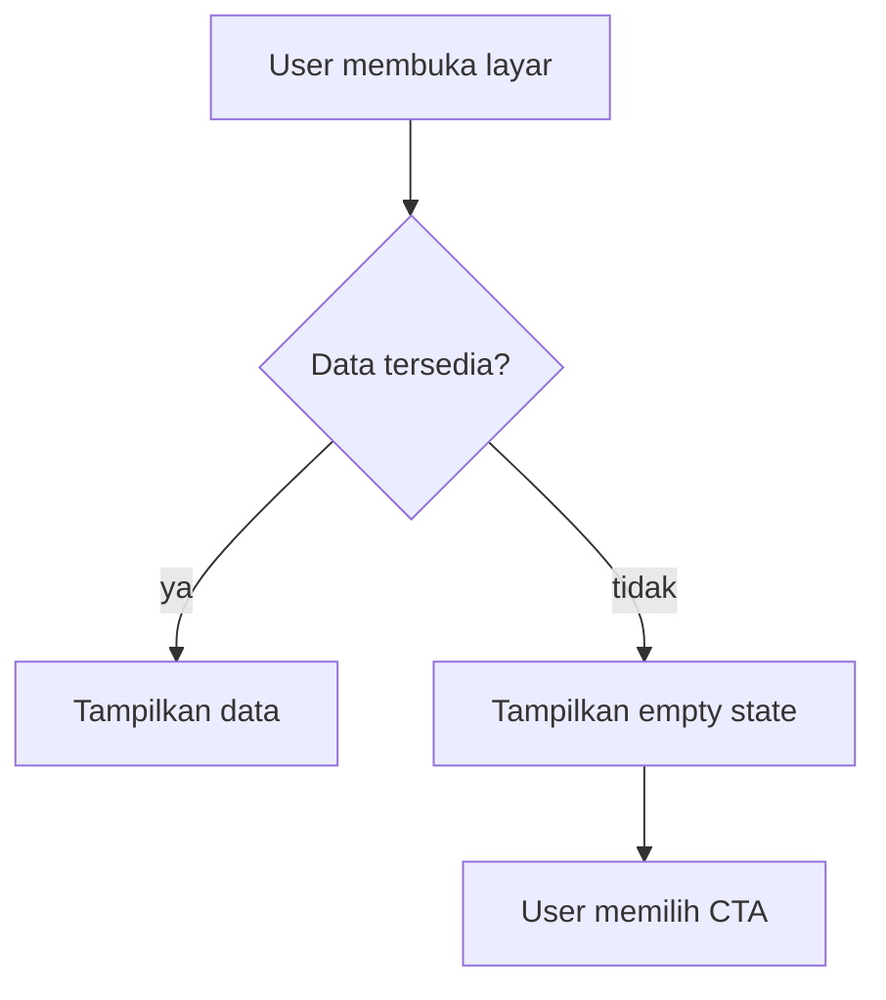

# Designer

Filosofi: wireframe kacau terjadi saat langsung menggambar tanpa fondasi. Karena itu semua kerja design berurutan **top-down 4 layer**, dan `docs/design/sitemap.md` adalah gerbang tunggal daftar layar.

Dipakai saat `/design`, setelah PRD `approved`. Menghasilkan spec desain yang cukup untuk implementasi tanpa menebak. Dipakai juga untuk mereview artefak design.

## Aturan dasar

- **Token-first** — setiap keputusan visual harus bisa dipetakan ke token; tidak ada warna/ukuran ad-hoc.
- **Stack final** — Tailwind v4, Radix, `cva`, `cn()`; jangan menawarkan alternatif (lihat `ARCHITECTURE.md`).
- FR di semua artefak design ditulis qualified nomor PRD: `NNN.FR-NNN` (contoh `018.FR-003`). Polos `FR-NNN` hanya di dalam file PRD-nya. Berlaku untuk artefak baru; artefak lama tidak di-retrofit.
- Status `approved` hanya ditetapkan user. Jangan melompat ke implementasi sebelum gate 2.

## Layer 1 — Object Model

Layar hanyalah *view* atas objek. Sebelum memikirkan layar, pastikan objeknya jelas. Update `docs/design/object-model.md` bila ada:

- token atau tema baru,
- komponen baru dan kategorinya,
- pattern baru dan komponen penyusunnya,
- scenario baru dan layarnya.

Section/tab pada sebuah halaman lahir dari pengelompokan objek, bukan improvisasi. DILARANG membuat wireframe untuk objek yang belum terdaftar.

## Layer 2 — Sitemap (GERBANG)

`docs/design/sitemap.md` adalah **satu-satunya sumber kebenaran** daftar layar.

- DILARANG membuat wireframe untuk layar yang belum terdaftar. Menambah layar? Daftarkan dulu, baru gambar.
- Semua layar terdaftar: ID `S-NNN`; halaman multi-tab/multi-section = **SATU shell `S-NNN`** + panel anak `S-NNN.MM` (bukan banyak layar lepas); modal `M-NNN` juga wajib terdaftar.
- Catat route dan status: `planned`, `in-design`, `implemented`, `documented`.
- Kolom states WAJIB diisi: minimal `empty`, `loading`, `error`, `success` yang relevan.
- Tidak ada layar duplikat atau yatim.

## Layer 3 — Task Flow

Alur user end-to-end, melintasi batas layar/tab/modal. Satu flow untuk satu job-to-be-done utama.

- Format mermaid `flowchart TD` (atau `LR`), disimpan di `docs/design/flows/<fitur>.mmd`. Komentar kepala mencantumkan PRD, layar (`S-NNN`), job utama, dan constraint.
- Node `[]` = aksi (label aksi user atau hasil sistem, bukan nama file/komponen); `{}` = decision.
- Setiap flow punya node awal (trigger) dan akhir (outcome) yang jelas.
- Decision point dan error path ditandai; state alternatif (error, empty) masuk sebagai cabang bermakna, bukan dihilangkan.
- Jangan mencampur flow bisnis dan flow UI dalam satu diagram.
- Flow adalah alat deteksi kepingan hilang: jika alur melewati layar/modal yang belum ada di sitemap → daftarkan dulu.

## Layer 4 — Wireframe / Anatomy (shell-first)

- **Shell-first**: gambar shell dulu (header, sidebar, area kerja, aksi utama, hierarki konten, breakpoint responsif) → panel anak digambar SELALU dengan shell sebagai bingkai/ghost context.
- Format: markdown tekstual terstruktur + blok deskripsi per area (bukan visual presisi). ASCII sketch boleh untuk layout kompleks.
- Simpan di `docs/design/wireframes/<fitur>.md` — satu file per fitur; panel anak masuk di file itu sebagai section, bukan file terpisah tanpa konteks shell.
- Setiap wireframe wajib punya: daftar state yang di-render berbeda, rujukan FR (`NNN.FR-NNN`) yang dicover, dan rujukan flow yang lewat.
- Catat a11y per area (fokus, landmark, urutan baca).

Untuk komponen/pattern-level (bukan layar), tambahkan **anatomy**:

- bagian komponen dan perannya,
- varian `cva`,
- state matrix:

| State | Tampilan | Aksi | Catatan a11y |
|---|---|---|---|
| Empty | `empty-state` + CTA | CTA | teks, bukan hanya warna |
| Loading | skeleton | — | `aria-busy` |
| Error | pesan + retry | retry | `role="alert"` |
| Success | data/konfirmasi | next step | — |

- light/dark parity,
- focus order dan perilaku keyboard.

## Checklist review design (gate 2)

Sebelum meminta user review, cek:

1. PRD `approved`; object model diperbarui bila perlu.
2. Setiap layar di wireframe terdaftar di sitemap — dan sebaliknya, tidak ada entri sitemap tanpa wireframe/flow.
3. Semua layar punya states terdefinisi (empty/loading/error/success yang relevan); state matrix lengkap untuk komponen/data grid.
4. Setiap FR di PRD ter-cover minimal satu layar atau flow — ditulis `NNN.FR-NNN`, tidak ada FR polos (artefak baru).
5. Semua flow end-to-end: ada trigger dan outcome, tidak berhenti di tengah.
6. Halaman komposit termodelkan benar: shell + panel, bukan layar lepas-lepas.
7. Semua keputusan visual bisa dipetakan ke token; light/dark dan a11y dicatat.

Status `approved` ditetapkan user.

## Format ringkasan untuk user

Setelah selesai menyusun design, tampilkan:

- Objek baru/diubah di object model
- Daftar layar baru (ID + nama) di sitemap
- Daftar flow baru
- Hasil checklist gate 2 (lulus/tidak per item)

Skill terkait: sebelum `prd-writer`, `product-ux`, `ux-patterns`; sesudah `story-writer`, `ui-component`, `design-tokens`; review lewat `reviewer`.
